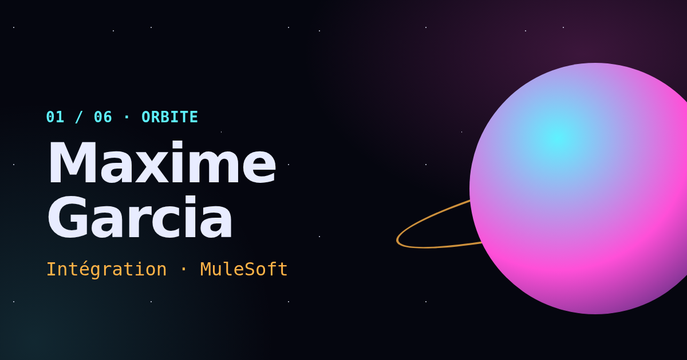

# Portfolio — Maxime Garcia

Portfolio d'un intégrateur qui joue de la guitare, dessine des jeux et explore l'espace. Concept « Orbite » : chaque section est une planète, une caméra 3D voyage de l'une à l'autre.

**Stack** : Astro 7 · React 19 · TypeScript strict · Tailwind CSS 4 · MDX · Three.js / React Three Fiber · GSAP · Lenis · nanostores · Vitest · Playwright · Vercel

Site en ligne : https://portfolio-umber-five-g3sqam9gtt.vercel.app (FR) et [/en/](https://portfolio-umber-five-g3sqam9gtt.vercel.app/en/) (EN)

## Fonctionnalités

- **Six planètes** : Départ, À propos (timeline), Compétences, Projets (filtres, fiches MDX), Passions (lecteur audio), Contact (Formspree).
- **Scène 3D procédurale**, chargée à la première intention ou via « Allumer les moteurs ». Le site est complet sans elle.
- **Bilingue** FR (racine) / EN (`/en/`), thème sombre ou clair « carte astronomique ».
- **Couche jeu** : six succès, code Konami, terminal de bord (`Ctrl/Cmd+K`, tapez `help`).
- **Son** coupé par défaut : micro-sons synthétisés, visualiseur réactif à la musique.
- **Accessibilité** : axe sans violation dans les deux thèmes, navigation au clavier, variante `prefers-reduced-motion` partout.

Contenus provisoires à remplacer : [docs/a-remplacer.md](docs/a-remplacer.md).

## Commandes

Prérequis : Node 22.23.4 ou plus, pnpm via `corepack enable`.

| Commande             | Rôle                                                       |
| -------------------- | ---------------------------------------------------------- |
| `pnpm install`       | Installe les dépendances                                   |
| `pnpm dev`           | Serveur de dev sur http://localhost:4321                   |
| `pnpm build`         | Build statique dans `dist/`                                |
| `pnpm test`          | Tests unitaires (Vitest)                                   |
| `pnpm test:coverage` | Tests unitaires + couverture (100 % sur la logique de jeu) |
| `pnpm budget`        | Budget JS initial (40 Ko gzip), après `pnpm build`         |
| `pnpm test:e2e`      | Tests E2E et accessibilité (Playwright)                    |
| `pnpm lint`          | ESLint                                                     |
| `pnpm typecheck`     | `astro check` (TypeScript strict)                          |

## Documentation

La documentation technique est dans [`docs/`](docs/) : architecture, stack, workflow avec Claude Code, animations, Git, déploiement [décisions d'architecture](docs/decisions/README.md) et [feuille de route](docs/roadmap.md).

## Licence

© Maxime Garcia. Tous droits réservés. Ce dépôt n'est pas sous licence libre.
