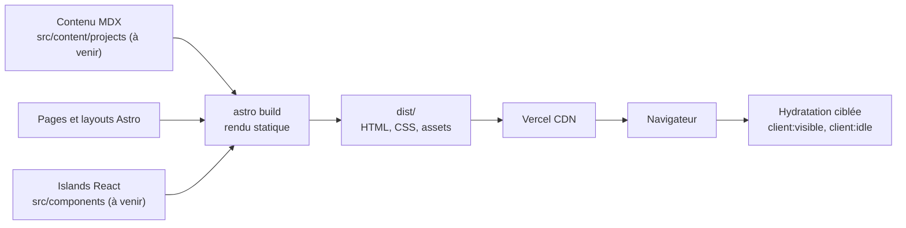

# Architecture

Le site est statique. Astro produit du HTML et du CSS au build. Du JavaScript n'est envoyé au navigateur que pour les **islands** React qui en ont besoin.

## Vue d'ensemble

- **Rendu statique** : `astro build` écrit `dist/`. Aucun serveur applicatif en production.
- **Zéro JS par défaut** : les composants `.astro` ne produisent aucun JavaScript côté client.
- **Islands React** : un composant React est hydraté seulement s'il porte une directive (`client:visible`, `client:idle`…). La 3D et les animations complexes vivent là.
- **Contenu** : les pages sont en `.astro`. Les fiches projets seront en MDX, dans des Content Collections validées par Zod (à venir).
- **Transitions** : View Transitions natives d'Astro entre les pages.
- **Repli sans 3D** : le contenu doit rester lisible sans WebGL.

## Flux



Le build sort du HTML pour toutes les pages. Les islands sont compilées à part et chargées par le navigateur quand leur directive l'exige.

## Arborescence `src/`

```
src/
├── components/        # composants Astro et islands React        (à créer)
├── layouts/           # BaseLayout.astro                          (présent)
├── pages/             # index.astro : page « Hello, universe »   (présent)
├── content/projects/  # fiches projets en MDX + schémas Zod      (à créer)
├── animations/        # timelines GSAP réutilisables             (à créer)
├── styles/            # global.css, Tailwind v4                   (présent)
└── lib/               # site.ts : SITE, pageTitle                 (présent)
```

Tests : `tests/unit/` (Vitest) et `tests/e2e/` (Playwright, desktop et mobile).

## Pistes ouvertes

- Content Collections et schémas Zod pour les projets.
- Première island 3D (React Three Fiber), chargée en `client:visible`.
- Décision sur la structure des pages de projets (routes dynamiques).

Voir aussi : [stack](stack.md), [animations](animations.md), [décisions](decisions/README.md).
