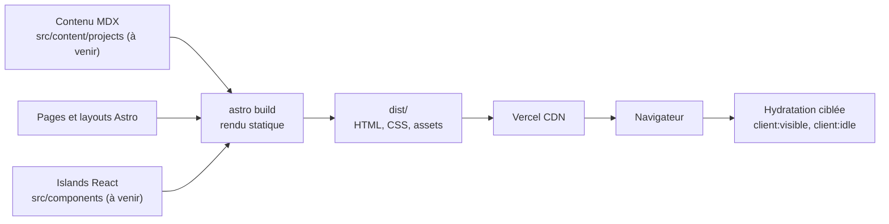

# Architecture

Le site est statique. Astro produit du HTML et du CSS au build. Du JavaScript n'est envoyé au navigateur que pour les **islands** React qui en ont besoin.

## Vue d'ensemble

- **Rendu statique** : `astro build` écrit `dist/`. Aucun serveur applicatif en production.
- **Zéro JS par défaut** : les composants `.astro` ne produisent aucun JavaScript côté client.
- **Islands React** : un composant React est hydraté seulement s'il porte une directive (`client:visible`, `client:idle`…). La 3D et les animations complexes vivent là.
- **Contenu** : les pages sont en `.astro`. Les fiches projets seront en MDX, dans des Content Collections validées par Zod (à venir).
- **Transitions** : View Transitions natives d'Astro entre les pages.
- **Repli sans 3D** : le contenu doit rester lisible sans WebGL.

## Flux



Le build sort du HTML pour toutes les pages. Les islands sont compilées à part et chargées par le navigateur quand leur directive l'exige.

## Arborescence `src/`

```
src/
├── animations/        # lenis.ts, timeline.ts (chargés en import dynamique)
├── audio/             # engine.ts, blips.ts, analyser.ts (Web Audio, à la demande)
├── components/
│   ├── hud/           # Hud.astro : carte stellaire et contrôles
│   ├── projects/      # cartes, couvertures générées, page détail
│   ├── sections/      # Hero, About, Skills, Projects, Passions, Contact
│   ├── space/         # SpaceScene.tsx (R3F), planètes, étoiles, nébuleuse, shaders/
│   ├── terminal/      # Terminal.tsx (island à la demande), commands.ts (logique pure)
│   └── ui/            # Badge
├── content/           # projects/{fr,en}/*.mdx, timeline.yaml
├── directives/        # client:intent (3D), client:event (terminal)
├── i18n/              # ui.ts (textes typés FR/EN), utils.ts
├── layouts/           # BaseLayout.astro : SEO, thème, ClientRouter, scène persistée
├── lib/               # site, schemas (Zod), projects, skills, achievements, capability
├── pages/             # index, en/index, projects/[id], en/projects/[id], 404
├── scripts/           # theme, motion, game, sound, konami, filters, contact, toasts
├── stores/            # nanostores : section, quality, achievements, sound, audio
└── styles/            # global.css : jetons, thèmes, failsafes
```

Tests : `tests/unit/` (Vitest, happy-dom pour le DOM) et `tests/e2e/` (Playwright, desktop et mobile, axe).

## Chargement du JavaScript

| Quoi                             | Quand                                |
| -------------------------------- | ------------------------------------ |
| Thème (inline `<head>`)          | Avant l'affichage                    |
| ClientRouter, HUD, jeu, son (UI) | Au chargement (environ 18 Ko gzip)   |
| GSAP + Lenis                     | Import dynamique après le chargement |
| Scène 3D (three, R3F)            | Première intention (`client:intent`) |
| Terminal (React, Motion)         | Première ouverture (`client:event`)  |
| Synthé et analyseur audio        | Premier clic sur ♪ ou premier `play` |

## Pistes ouvertes

- Remplacer les contenus provisoires ([a-remplacer.md](a-remplacer.md)).
- Nom de domaine : mettre à jour `site`, `robots.txt` et `PRODUCTION_URL`.

Voir aussi : [stack](stack.md), [animations](animations.md), [décisions](decisions/README.md).
